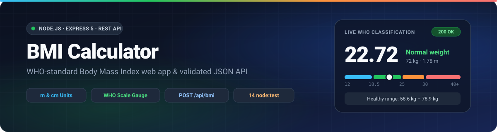
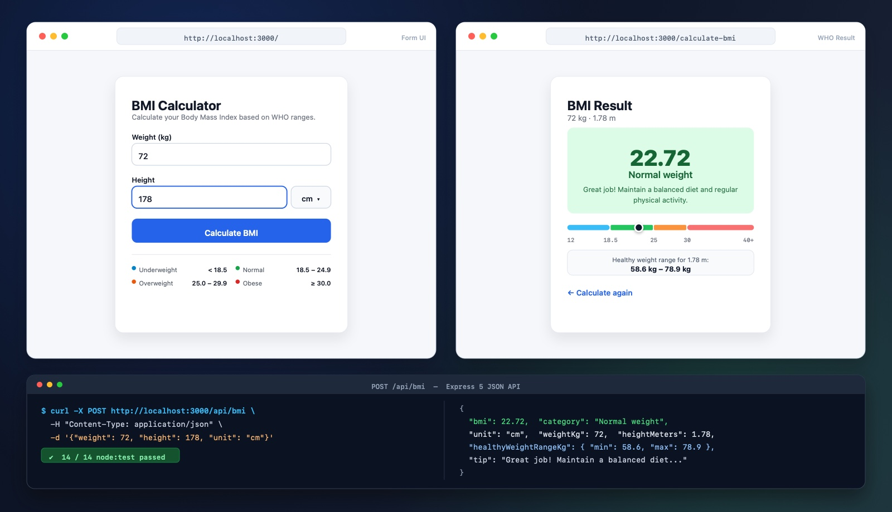
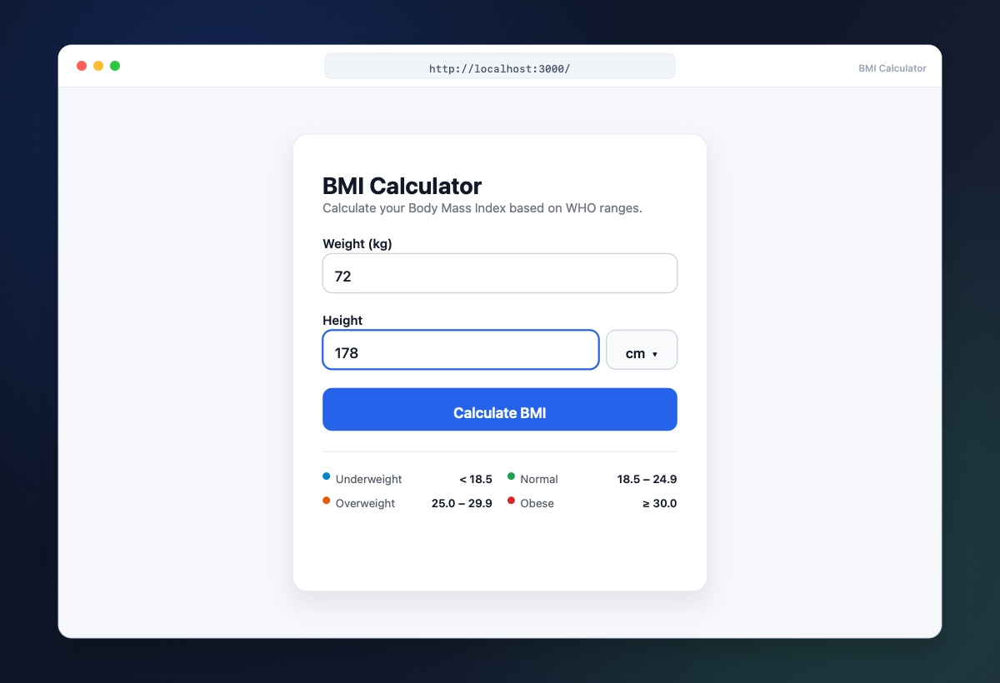
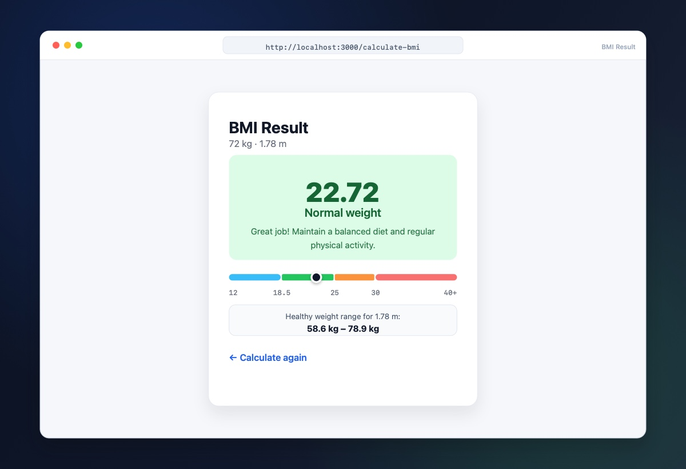
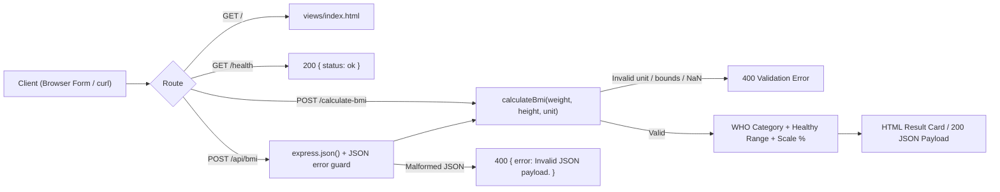

<div align="center">



<br /><br />

[](https://nodejs.org/)
[](https://expressjs.com/)
[](tests/bmi.test.js)
[](LICENSE)

**WHO-standard Body Mass Index web application and validated JSON REST API built with Node.js and Express 5.**  
Supports meters (`m`) and centimeters (`cm`), realistic anthropometric bounds, healthy weight range calculation, and zero-dependency native `node:test` coverage.

[Quick Start](#quick-start) · [UI Walkthrough](#ui-walkthrough) · [API Reference](#api-reference) · [Architecture](#request--validation-flow) · [Testing](#testing)

</div>

---

<p align="center">
  
</p>

## Key Highlights

- **Dual Web UI + JSON API** — Server-rendered HTML workflow (`POST /calculate-bmi`) alongside a clean JSON endpoint (`POST /api/bmi`) and health probe (`GET /health`).
- **Strict Input Validation** — Rejects unsupported units, booleans, empty strings, `NaN`/`Infinity`, malformed JSON payloads (`400`), and unrealistic bounds (`1–500 kg`, `0.4–3.0 m` / `40–300 cm`).
- **WHO Scale Gauge & Healthy Range** — Renders a 4-segment WHO BMI indicator bar with a positioned score pin plus the healthy weight interval (`18.5 × h²` to `24.9 × h²`) for the user's height.
- **Zero-Dependency Test Suite** — 14 unit and live Express HTTP integration tests using Node's built-in `node:test` and `node:assert/strict` (`npm test`).
- **Minimal Footprint** — Single production dependency (`express@^5.2.1`) and clean vanilla HTML/CSS with progressive unit-switching UX.

---

## UI Walkthrough

<table>
  <tr>
    <td width="50%">
      
      <p align="center"><strong>1. Input Form (<code>GET /</code>)</strong><br />Dynamic <code>m</code>/<code>cm</code> unit switching updates height bounds &amp; placeholders alongside the WHO reference legend.</p>
    </td>
    <td width="50%">
      
      <p align="center"><strong>2. WHO Result Card (<code>POST /calculate-bmi</code>)</strong><br />Color-coded classification, actionable guidance, visual 4-segment WHO gauge, and healthy weight range.</p>
    </td>
  </tr>
</table>

---

## WHO Classification Ranges

| Category | BMI Range (`kg/m²`) | Indicator | Guidance |
| :--- | :---: | :---: | :--- |
| **Underweight** | `< 18.5` | `blue` | Nutrient-dense diet and strength training |
| **Normal weight** | `18.5 – 24.9` | `green` | Maintain balanced nutrition and regular activity |
| **Overweight** | `25.0 – 29.9` | `orange` | Regular cardio and balanced portions |
| **Obese** | `≥ 30.0` | `red` | Consult a healthcare professional for a tailored plan |

---

## Request & Validation Flow



---

## API Reference

| Method | Path | Content-Type | Description |
| :--- | :--- | :--- | :--- |
| `GET` | `/` | `text/html` | Renders the BMI calculator web interface |
| `GET` | `/health` | `application/json` | Service health check (`{ "status": "ok", "service": "bmi-calculator-node" }`) |
| `POST` | `/calculate-bmi` | `application/x-www-form-urlencoded` | Calculates BMI and renders the color-coded HTML result card |
| `POST` | `/api/bmi` | `application/json` | Validates input and returns structured JSON (`200` or `400`) |

### `POST /api/bmi` Example

```bash
curl -X POST http://localhost:3000/api/bmi \
  -H "Content-Type: application/json" \
  -d '{"weight": 72, "height": 178, "unit": "cm"}'
```

**Response (`200 OK`):**

```json
{
  "bmi": 22.72,
  "category": "Normal weight",
  "tip": "Great job! Maintain a balanced diet and regular physical activity.",
  "unit": "cm",
  "weightKg": 72,
  "heightMeters": 1.78,
  "healthyWeightRangeKg": {
    "min": 58.6,
    "max": 78.9
  }
}
```

**Validation Error (`400 Bad Request`):**

```json
{
  "error": "Unit must be 'm' or 'cm'."
}
```

---

## Quick Start

### Prerequisites

- **Node.js 18+** (tested on Node 20 and Node 22)

### Run Locally

```bash
git clone https://github.com/Alizhan-T/bmi-calculator-node.git
cd bmi-calculator-node
npm ci
npm start
```

Open [http://localhost:3000](http://localhost:3000) in your browser. Override the port with `PORT=8080 npm start`.

---

## Testing

The test suite uses Node's built-in test runner (`node:test`) with zero external test dependencies:

```bash
npm test
```

Covers **14 automated tests** across 2 suites:
- **`calculateBmi` unit tests (8):** all 4 WHO categories, `m` vs `cm` equivalence, boundary thresholds (`18.5`, `25.0`, `30.0`), unsupported units, boolean/null/NaN inputs, and realistic weight/height bounds.
- **HTTP integration tests (6):** live Express 5 server checks for `GET /`, `GET /style.css`, `GET /health`, `POST /api/bmi` (valid, invalid unit, missing body, malformed JSON), and `POST /calculate-bmi` (200 HTML result & 400 error page).

---

## Project Structure

```text
bmi-calculator-node/
├── index.js                 # Express 5 app, calculateBmi logic, routes & error handling
├── views/
│   └── index.html           # Calculator form UI with progressive m/cm switching
├── public/
│   └── style.css            # Responsive card layout, WHO legend & BMI gauge styles
├── tests/
│   └── bmi.test.js          # 14 unit + HTTP integration tests (node:test)
├── assets/
│   ├── banner.svg           # Repository hero banner
│   ├── showcase.jpg         # Combined UI + JSON API showcase
│   └── screens/             # Individual form & result screenshots
├── package.json
└── LICENSE
```

---

## License & Author

Released under the [MIT License](LICENSE).  
Built by **[Alizhan Toleukhan](https://alizhan-t.github.io/)** ([`@Alizhan-T`](https://github.com/Alizhan-T)).
